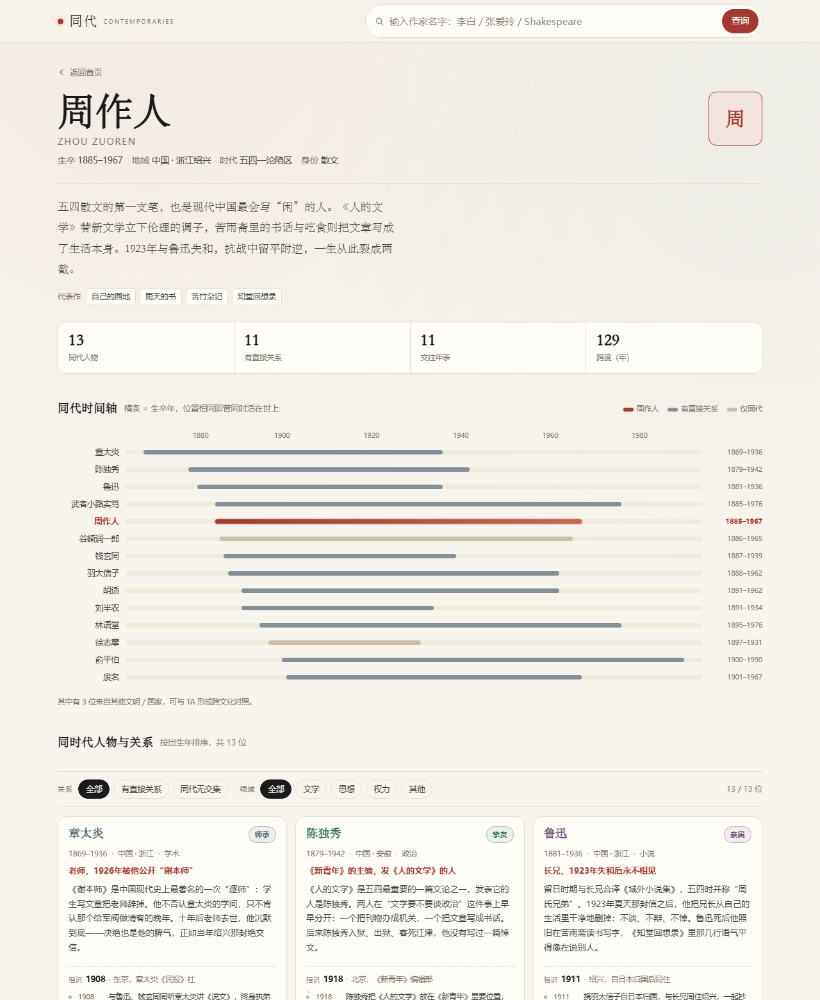

# 同代 · Contemporaries

输入一位作家的名字，立刻看到与 TA **同时代**的著名人物——诗人、哲人、科学家、画家、君王——以及两人**何时相识、交往中发生了什么、关系怎么结束**。

不分古今中外。纯静态页面，零依赖，零后端，打开即用。



## 为什么做成这样

「同时代的所有著名人物」本质上不是一份名单，而是一个**时间重叠**问题。所以页面分三层：

1. **同代时间轴** —— 把每个人的生卒年画成一根横条。横条位置相同，就意味着他们曾在同一个世界里呼吸过。李白出生于 701 年时，贺知章已经 42 岁；杜甫小他 11 岁；王维与他同岁，却一生没有一首唱和留存。这些事用文字解释很费力，用条形图是一眼就懂的。
2. **关系卡片** —— 每张卡写清：关系类型徽章、一句话概括的关系、具体史实，以及一条「生命重叠」进度条（例：*同世 43 年 · 占李白一生的 70%*）。
3. **交往年表** —— 卡片下半部分是这次改版加的重点：`相识 744 年 · 洛阳`，其下按时间列出这段关系里真正发生过的事。**关系如何终结也照写**，绝交、反目、背弃用红点单独标出。

## 里面有什么

- **532 位作家**：中国 205 位（屈原 → 莫言 / 迟子建）、世界 327 位（荷马 → 村上春树 / 帕慕克 / 鲁西迪），跨 2800 年
- **5835 条人物关系**，涉及 **2929 位时代人物**，覆盖文学、思想、科学、艺术、权力五类
- **4170 条关系带完整交往年表**，共 **10087 个事件**：哪天初遇、同游何处、写了哪首诗、哪封信、哪次争吵；其中 1871 条的相识年份可考
- **2765 条关系写明了终结方式**（多为一方的死亡），其中 185 条是绝交、反目、决裂、背弃、离婚
- **无关也照写**：同一时代但确无交集的人，标注为「同代无交集」，并说明他们当时各自在做什么
- **反向查询**：输入「爱因斯坦」「拿破仑」「宋徽宗」，会告诉你 TA 是哪几位作家的同时代人

### 一些被完整记下的「关系崩坏」

| 关系 | 始末 |
|---|---|
| 嵇康 × 山涛 | 同为竹林七贤，嵇康写《与山巨源绝交书》；临刑前却把儿子托付给山涛 |
| 苏轼 × 章惇 | 青年好友 → 一贬惠州、再贬儋州，苏轼在贬所写信称「不意老兄相迫至此」 |
| 伏尔泰 × 卢梭 | 先互赠著作，后因《论不平等》与宗教观彻底反目，伏尔泰骂他「反人类」 |
| 托尔斯泰 × 屠格涅夫 | 1861 年费特家宴上争执，几乎决斗，断交 17 年，1878 年才和解 |
| 萨特 × 加缪 | 1943 年相识，1952 年因《反抗者》与《现代》杂志的书评决裂，至死未和解 |
| 周作人 × 鲁迅 | 1923 年八道湾兄弟失和，原因至今成谜，此后再无往来 |
| 马尔克斯 × 略萨 | 1976 年墨西哥城影院门口一拳，此后数十年不相往来 |
| 三岛由纪夫 × 太宰治 | 1946 年见面，三岛当面说「我讨厌你」，太宰回「那你为什么来」 |
| 林语堂 × 鲁迅 | 1929 年南云楼上一场争执，从此六年不相见，鲁迅逝世后林语堂仍写文悼念 |
| 周作人 × 章太炎 | 1926 年周作人公开发表《谢本师》，与老师划清界限，民国学界震动 |
| 张爱玲 × 胡兰成 | 1944 年结婚、1947 年决绝分手，附上三十万元稿费作分手礼 |
| 三毛 × 荷西 | 1973 年撒哈拉结婚，1979 年荷西潜水溺亡，她此后写的每一篇都在往回走 |

## 使用

```bash
git clone https://github.com/tomo614/tongdai.git
cd tongdai
open index.html          # macOS
# start index.html       # Windows
```

或者起个静态服务：

```bash
python3 -m http.server 8000
# 打开 http://localhost:8000
```

搜索支持本名、笔名、英文名（「苏东坡」「莎翁」「伍尔夫」都可以）。按 `/` 可快速聚焦搜索框。

## 结构

```
.
├── index.html              页面骨架
├── assets
│   ├── style.css           样式（含深色模式变量）
│   └── app.js              路由、搜索、时间轴、卡片与年表渲染
├── data
│   ├── cn-a.js … cn-c.js   中国作家（先秦–唐 / 五代–清 / 近现代）
│   └── w-a.js … w-e.js     世界作家（古典–18C / 19C / 20C / 当代 / 亚洲）
├── docs/preview.png
└── .dev
    ├── SPEC.md             数据撰写规范
    └── validate.js         数据校验器
```

## 数据结构

```js
{
  id: "libai", name: "李白", en: "Li Bai",
  alias: ["李太白", "青莲居士"],
  birth: 701, death: 762,
  country: "中国 · 唐", era: "盛唐", field: "诗歌",
  bio: "……",
  works: ["将进酒", "蜀道难"],
  peers: [
    {
      n: "杜甫", e: "Du Fu",
      b: 712, d: 770,
      c: "中国 · 唐", f: "诗歌",
      t: "friend",                 // 关系类型
      r: "挚友：一生念念不忘",       // 关系短语
      met: 744,                    // 相识年份（null = 年月失载）
      metAt: "洛阳",                // 相识地点 / 契机
      ev: [                        // 交往年表
        { y: 744, e: "洛阳初遇，同游梁宋，与高适三人同行，访道寻仙" },
        { y: 745, e: "石门分别，李白南下江东，杜甫西去长安" },
        { y: 746, e: "杜甫客居长安，写下《春日忆李白》" }
      ],
      end: 762,                    // 关系终结年份（可省略）
      endWhy: "李白病逝当涂，杜甫此后写《不见》",  // 终结方式
      x: "……"                      // 60–160 字总述
    }
  ]
}
```

关系类型 `t`：`friend` 挚友 · `rival` 论敌 · `mentor` 师承 · `family` 亲属 · `circle` 同圈 · `patron` 知遇 · `context` 背景 · `influence` 影响 · `none` 同代无交集。

## 增加一位作家

1. 在 `data/` 任一文件末尾追加一个对象（外壳是 `window.AUTHORS = (window.AUTHORS || []).concat([ … ]);`）
2. 按 `.dev/SPEC.md` 填字段，每条 `t !== "none"` 的关系都要有 `met` 和至少一条 `ev`
3. 校验：

```bash
node .dev/validate.js
```

校验器会检查必填字段、生卒年逻辑、关系类型是否合法、`none` 类型是否误写年表、年表与相识年份是否缺失，并输出全库统计。当前基线是 **0 错误**。

## 关于准确性

生卒年取通行说法，有争议的写作「约」。年月确实失载的地方写「年月失载」或 `null`，**不作推测、不编造精确年份**。人物关系与事件为人工整理，仅供阅读与启发，不作学术引用依据。

## License

[MIT](LICENSE)
